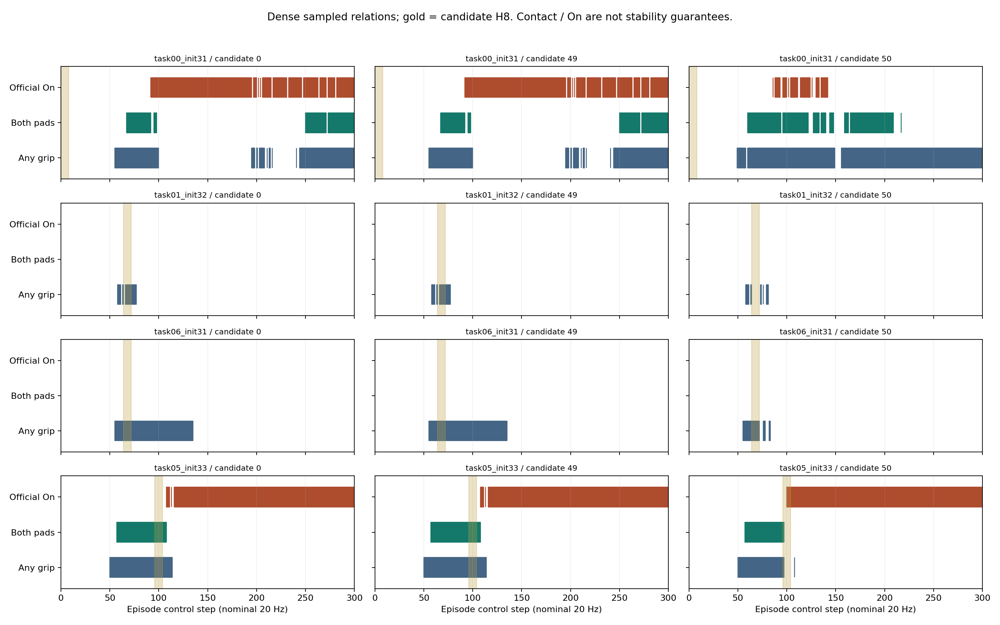

# 密集关系事件记录：技术preflight结果

日期：2026-10-06（Asia/Shanghai）。**`TECHNICAL_RECORDING_VALID`：密集记录与旧分支身份核验通过。**

**这一步解决了“能否可信地记录关系事件”的技术问题，没有证明关系模型可学、候选选择有效或跨任务泛化。**

已执行4个旧起点、12条唯一分支和1条A0重复，共13条完整运行、3,900个环境控制步（包含全部prefix/H8/续行）。耗时206.00秒。没有额外重试、新scene或训练。

## 1. 记录是否改变了原实验

13条运行全部通过：root身份、H8 RGB与诊断、实际完整动作哈希、首次success、success及最终诊断与旧分支一致。第一起点的两次A0所有密集数组完全相同。旧worker、C0和观测刷新时序不变，只在控制步末读取仿真字段。

记录了3,913个initial/控制步末样本，其中去掉A0重复后是3,612个；不同候选共享prefix，不能当独立样本。重新从保存的接触geom对构造左右指腹、任意夹爪、非夹爪与实体接触，与保存字段逐项一致；双指腹接触也与官方瞬时grasp一致。

新记录包括物体/夹爪pose与速度、qpos/qvel、有序实际动作、逐geom接触对/距离/接触坐标系/六维wrench、On和success。力为MuJoCo控制步末求解器快照，不是整个控制间隔的累计冲量或每个物理子步历史。

## 2. 现在能观察到什么

下面仅列12条唯一分支。首次接触是任意夹爪接触，不是稳定抓取；候选窗口有任意一个成立就记“有”。窗口含首尾共11个样本，覆盖10个控制间隔，名义0.5秒。

| root / 候选        | 首次任意接触步 | 首次双指腹步 | 持续抓取候选 | 抬起保持候选 | 释放放置候选 |
| ------------------ | -------------: | -----------: | ------------ | ------------ | ------------ |
| task00_init31 /#0  |             55 |           67 | 有           | 有           | 有           |
| task00_init31 /#49 |             55 |           67 | 有           | 有           | 有           |
| task00_init31 /#50 |             49 |           60 | 有           | 有           | 无           |
| task01_init32 /#0  |             58 |         None | 无           | 无           | 无           |
| task01_init32 /#49 |             58 |         None | 无           | 无           | 无           |
| task01_init32 /#50 |             58 |         None | 无           | 无           | 无           |
| task06_init31 /#0  |             55 |         None | 无           | 无           | 无           |
| task06_init31 /#49 |             55 |         None | 无           | 无           | 无           |
| task06_init31 /#50 |             55 |         None | 无           | 无           | 无           |
| task05_init33 /#0  |             50 |           57 | 有           | 有           | 有           |
| task05_init33 /#49 |             50 |           57 | 有           | 有           | 有           |
| task05_init33 /#50 |             50 |           57 | 有           | 有           | 有           |

操作性候选定义：持续抓取候选要求窗口内双指腹接触一直成立，目标在夹爪局部坐标中的位置相对窗口首帧偏移不超过5mm；抬起保持候选还要求没有非夹爪接触，并相对上一次非夹爪接触时高度上升超过5mm；释放放置候选要求此前曾有夹爪接触，窗口内目标On成立、夹爪不接触、有非夹爪接触且物体线速度低于0.02m/s。

这些是可核查的候选证据，不是普适稳定性真值。仅有任意接触史不保证此前被稳定持有；低线速度不等于姿态静止；窗口结束后的滑落仍可能发生。抬起参照非夹爪接触也不自动证明该接触承重。力记录使后续检验成为可能，本轮没有用它声称完成承重证明。

采集前冻结了4/10/20步窗口、1/5/10mm平移范围和释放低速条件；具体抬起参照及候选提取实现属于本次描述性分析，不是独立预注册效能检验。没有根据Y调阈值，没有拟合选择器。完整敏感性网格保存在analysis.json。

完整运行中的候选证据覆盖：持续抓取6/12、抬起保持6/12、释放放置5/12。这些分支共享4个起点，且包含候选干预前的prefix；不代表12个独立事件，也不全由候选动作造成。

仅计起点之后开始的窗口，分别覆盖5/12、3/12、5/12。起点之前的历史可以帮助状态估计，不能计为候选干预收益。



图中蓝色是任意夹爪接触，绿色是双指腹接触，橙色是官方On，淡黄色为原候选H8窗口。On与抓取可能重叠，说明官方成功不要求释放。图展示控制采样点的关系，不保证两个采样点之间没有瞬时变化。

## 3. 当前结论与下一步

技术验证已通过：可以在不改变旧执行结果的情况下获得逐控制步接触、运动和事件窗口。密集prefix与续行补上了原先H8四帧之外的过程证据。

下一步建议先冻结事件标签v1并设计覆盖阶段、失败方式及独立scene的数据采集，而不是立刻宣称完成模型训练。重点处理支撑力/净空、对称物体姿态、窗口截断及错误物体身份，并明确哪些事件仍标未知。小规模记录只证明采集接口可用。

本轮没有密集RGB录制，记录面向物理标签技术验证；旧root/H8图像和原策略观测节奏仍在。自然观测关系估计训练需要另行约定时间对齐的RGB/历史，不能直接把本轮数值状态当自然输入。现有4起点和固定候选也不足以声称新的泛化集。

## 4. 产物与复核

- [执行前协议](dense_relation_preflight_protocol.md) / [冻结JSON](../configs/dense_relation_preflight_protocol.json)
- [运行状态](../results/dense_relation_preflight/runtime.json) / [完整分支manifest](../results/dense_relation_preflight/manifest.json)
- [分析与逐分支事件区间](../results/dense_relation_preflight/analysis.json)
- [A0全数组重复检查](../results/dense_relation_preflight/repeat_check.json) / [数据访问账本](../results/dense_relation_preflight/access_ledger.json)
- [采集脚本](../scripts/run_dense_relation_preflight.py) / [只读分析](../scripts/analyze_dense_relation_preflight.py)
- [窗口与物理反例测试](../tests/test_dense_relation_preflight.py)

5项测试通过：时间窗样本数与时长、接触中断、手动而物体未跟随、抬起需要先前接触及脱离、持有或高速运动不能当释放放置。完整密集数组验证也通过。未重跑完整仓库测试。

仅使用旧任务0/1/5/6的init31–34容器中的允许数值行；不打开HDF5或新增demo分区。本轮确实运行了固定C0续行和官方success诊断，但没有训练、学习式controller/reranker、新候选生成或新scene实验。旧授权、teacher与结果未修改。

只读复算（不重新采集）：

```bash
env -u PYTHONPATH .venv/bin/python scripts/analyze_dense_relation_preflight.py
env -u PYTHONPATH .venv/bin/python scripts/report_dense_relation_preflight.py
env -u PYTHONPATH .venv/bin/python -m pytest -q tests/test_dense_relation_preflight.py
```
